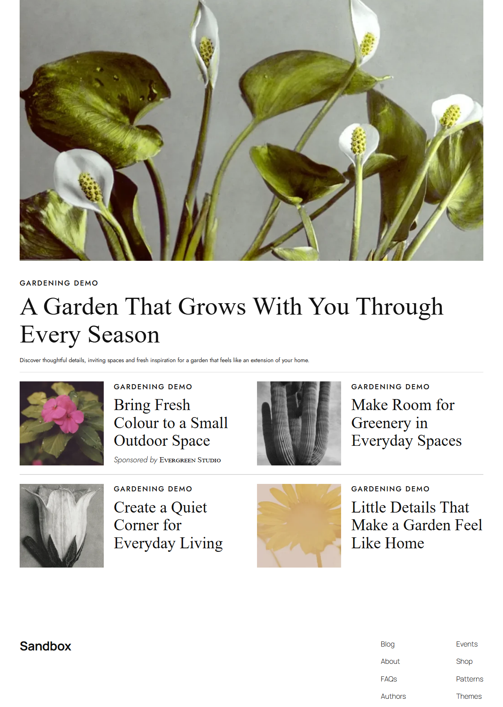

# Are Media Category Articles

This WordPress Gutenberg plugin was developed with AI assistance to display up to
five posts from a selected category: the newest as a featured article, followed
by four smaller cards.
The responsive layout includes optional category labels and featured-article
subtext, plus a bundled placeholder for missing images.



[Mobile screenshot](docs/images/wordpress-mobile.png)

## System requirements

| Component | Requirement | Verified development environment |
| --- | --- | --- |
| WordPress | 6.6+ with the block editor, declared in plugin metadata | 7.1.2 |
| PHP | 7.4+, declared in plugin metadata | 8.2.29 |
| Node.js | `^22.22.2` or `^24.15.0`, declared in `package.json` | 24.21.0 |
| npm | No version range declared; use npm supplied with a supported Node.js release | 11.19.0 for build/tests; dependency installation unverified |


Additional prerequisites: a working WordPress installation, plugin installation
permissions, and a browser supporting CSS container queries. Git and access to
this private GitHub repository are needed for cloning. Composer is optional for
PHP coding-standards checks. The optional browser-check script requires Windows
PowerShell, PHP and Microsoft Edge.

## Installation from GitHub

Both methods require access to the private repository and Node.js/npm to build
the plugin. Compiled assets in `build/` are excluded from GitHub source downloads.

### Method 1: Clone with Git

1. Obtain access to [jlrampola/aremedia-gutenberg](https://github.com/jlrampola/aremedia-gutenberg)
   and authenticate Git with GitHub using your usual secure method.
2. From your WordPress installation directory, clone into `wp-content/plugins/`:

   ```sh
   cd wp-content/plugins
   git clone https://github.com/jlrampola/aremedia-gutenberg.git aremedia-gutenberg
   cd aremedia-gutenberg
   ```

3. Install development dependencies and build production assets:

   ```sh
   npm install
   npm run build
   ```

   `npm install` supplies the JavaScript/CSS lint tools. The build itself has no
   external dependencies, so `npm run build` also works without installation if
   you only need to run the plugin.
4. Open **Plugins > Installed Plugins** in WordPress and activate
   **Are Media Category Articles**.

### Method 2: Download the repository ZIP

1. Sign in to GitHub and open
   [jlrampola/aremedia-gutenberg](https://github.com/jlrampola/aremedia-gutenberg).
   Select the branch you want to install, then choose **Code > Download ZIP**.
2. Extract the ZIP and rename its extracted top-level folder to
   `aremedia-gutenberg` (remove any branch-name suffix).
3. Move that folder into your WordPress installation's `wp-content/plugins/`
   directory. Ensure the entry file is directly at
   `wp-content/plugins/aremedia-gutenberg/aremedia-gutenberg.php`, without an
   extra nested folder.
4. Open a terminal in `wp-content/plugins/aremedia-gutenberg/` and run:

   ```sh
   npm install
   npm run build
   ```

   As with Method 1, dependency installation supplies lint tools; the build can
   run independently if you only need to use the plugin.
5. Open **Plugins > Installed Plugins** in WordPress and activate
   **Are Media Category Articles**.

The repository ZIP is source code, not a ready-to-install WordPress ZIP. Extract
and build it before activation. For either method, keep the generated `build/`
directory inside the plugin folder and rebuild after updating the source.

## Usage

1. Edit a post or page with the block editor. Open the inserter and search for
   **Category Articles**, also listed under **Widgets**.
2. Select the block and open **Article settings** in the block settings sidebar.
3. Choose a **Category**. Empty categories are included in the dropdown.
4. Adjust the toggles, both enabled by default:
   - **Display category label** shows the selected category's name on every article.
   - **Show subtext (excerpt)** shows the featured article's excerpt, up to 30 words.
5. Check the live preview, then save or publish the containing post/page.

Only published, non-password-protected posts directly assigned to the selected
category appear; child-category assignments alone do not qualify. Publication
date determines order, newest first; equal dates use post ID descending. Sticky
posts receive no priority. The first post is featured; the next four fill the
desktop grid left to right, then the next row. On narrow screens, cards stack.

Fewer than five posts produce only the available articles. An empty category
shows an editor message and renders nothing on the frontend. Missing featured
images use the bundled neutral SVG placeholder.

New publications appear on subsequent frontend page requests without editing or
resaving the block. Already-open pages do not refresh automatically, and page/CDN
caches may delay changes.

Optional sponsorship: edit an article and open **Post > Sponsorship** in the
editor settings sidebar. Enter a **Sponsor name**, then save or update the post.
Leave the field blank and save to remove sponsorship. Smaller cards display
**Sponsored by [brand]**; the featured article does not. Existing
`aremedia_sponsor` custom-field values appear in this field automatically.

## Development

```text
aremedia-gutenberg.php   Registration, shared query rules, sponsor metadata
src/block.json          Block metadata and saved settings
src/index.js            Editor controls and REST-backed preview
src/sponsor.js          Dedicated sponsor field in the post settings sidebar
src/render.php          Dynamic frontend template
src/style.css           Shared editor/frontend styles
src/assets/             Missing-image placeholder SVG
src/fonts/              Bundled Jost fonts and license
build/                  Generated runtime files; ignored by Git
tests/                  Node/PHP tests and preview fixtures
tools/                  Build/watch and browser checks
docs/images/            Block screenshots
reference/              Supplied typography reference
```

Run commands from the repository root:

| Command | Purpose |
| --- | --- |
| `npm install` | Install development dependencies (`@wordpress/scripts` 37.0.0) |
| `npm run build` | Generate production assets using `node tools/build.mjs` |
| `npm start` | Build and watch `src/` using `node tools/build.mjs --watch`; stop with Ctrl+C |
| `npm test` | Run Node editor-contract and build tests |
| `npm run test:php` | Run PHP renderer/query tests; requires `php` on PATH |
| `npm run lint:js` | Run WordPress JavaScript linting |
| `npm run lint:css` | Run WordPress CSS linting |

For PHP coding standards, run `composer install`, then `composer lint`.
Edit `src/` and rebuild rather than editing generated files. No dependency
lockfiles are currently committed. Browser checks write temporary files outside
the repository and retain their screenshots in `docs/images/`.

### Implementation decisions

- The block is dynamic: it saves settings, not article snapshots. PHP queries posts on each
  uncached frontend render; no frontend JavaScript is required.
- The editor uses WordPress core-data and the existing posts REST endpoint, with a
  scoped `aremedia_category` parameter sharing the PHP query rules.
- The frontend uses WordPress's excerpt API. Third-party excerpt filters can
  cause differences from the REST-based editor preview.
- The selected category supplies every category label. Sponsorship does not
  suppress that label; excerpts appear only on the featured article.
- Headlines use Times New Roman; supporting text uses locally bundled Jost.
  These are visual matches to the reference, whose original font names were
  unavailable. Featured subtext uses 15px, normal style and weight 400.

## AI tool usage

The following tools were used during development:

| Tool or workflow | Purpose |
| --- | --- |
| OpenAI Codex, including reviewer agents | Requirements/design analysis, implementation, tests, debugging, documentation and code review |
| Superpowers, Ponytail and Caveman skills within Codex | Development workflow, scope control and response style |
| Codex browsing and GitHub integration | Consulting official WordPress documentation and checking repository/account access |

### Changes to AI-generated output

The generated output was refined with AI assistance. Those revisions
included public REST context for editorial roles, WordPress's block-aware
excerpt API, sponsor placement, translations and the mobile test fixture.
Typography, spacing and image proportions were adjusted against the supplied
references, and the missing-image fallback was replaced with a bundled SVG.
Regression checks accompanied the REST-context and excerpt corrections.
The dedicated sponsor panel and its tests were also added with AI assistance.

Substantial parts of the code, tests and documentation were AI-generated.
These revisions were also AI-assisted and are not presented as unaided manual
edits. The developer's independent code review and no-AI rehearsal remain pending.

## Known limitations and possible future improvements

| Current feature limitation | Possible future improvement |
| --- | --- |
| One category per block; only standard posts directly assigned to it are included. | Optional child-category inclusion or multiple-category selection. |
| Fixed maximum of five posts, ordered newest first; no pagination or manual selection. | Configurable article count or editorial post selection. |
| Excerpts appear only on the featured article and are limited to 30 words. | Configurable excerpt length and optional card excerpts. |
| New publications appear on new page requests; open pages do not update automatically, and caches may delay changes. | Optional automatic refresh with cache-aware updates. |
| Sponsorship supports a text brand name on smaller cards only. | Sponsor logos or optional featured-article sponsorship. |

These are optional enhancements, not implemented features. The current controls
remain limited to category selection, category labels and featured-article subtext;
sponsor names are edited separately in the post's Sponsorship panel.

## Validation status

Build, watch and tests have been exercised through the AI-assisted workflow.
The sponsor panel was verified in WordPress for loading an existing name,
saving a changed name, clearing it and retaining those changes after reopening.
Dependency installation and official JS/CSS/PHP standards checks remain blocked.
Minimum-version, cross-browser, role-specific and full keyboard/screen-reader
checks and fresh-clone installation remain unverified.

License: GPL-2.0-or-later. Bundled Jost fonts use the
[SIL Open Font License](src/fonts/OFL.txt).
